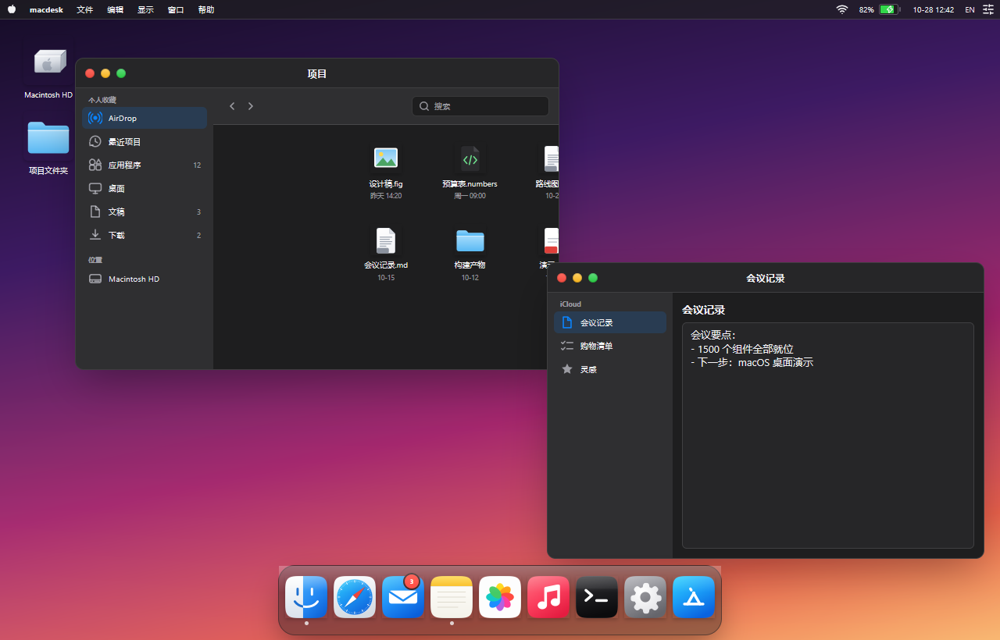
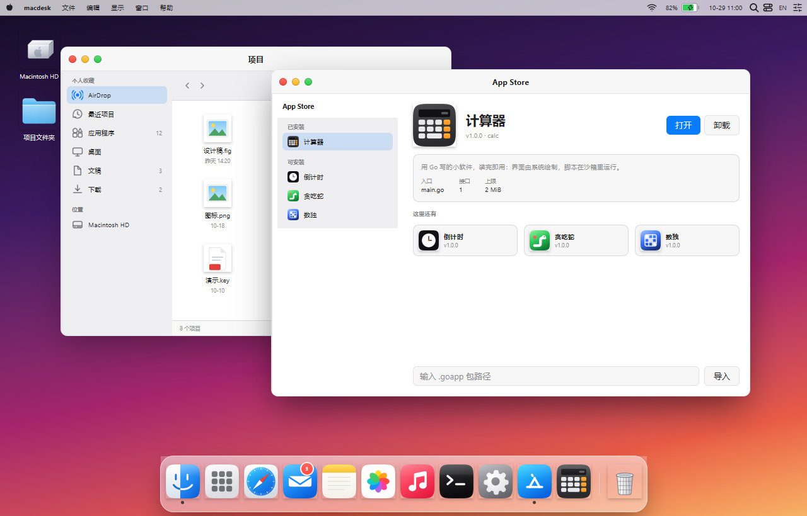
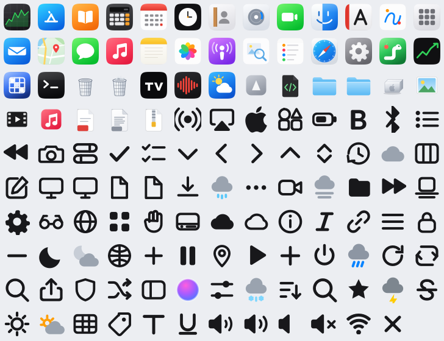
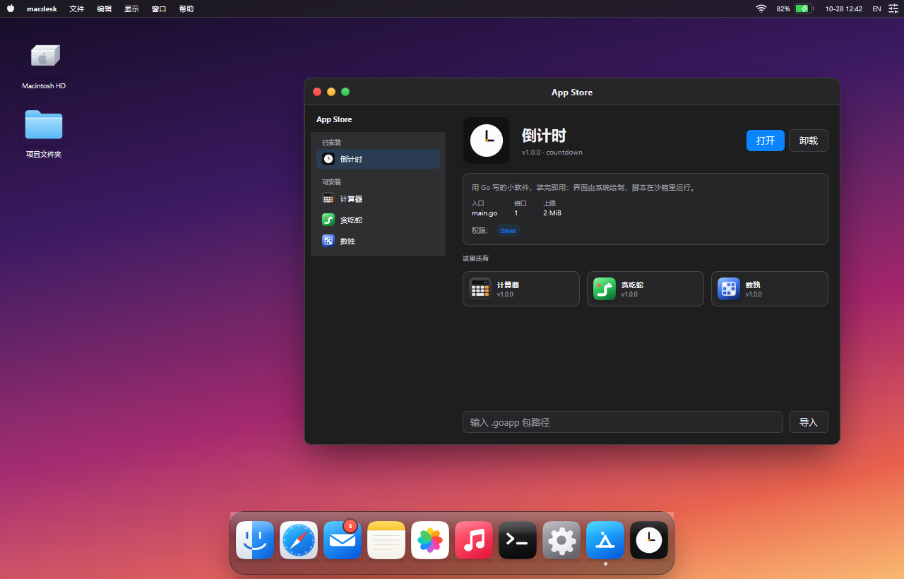
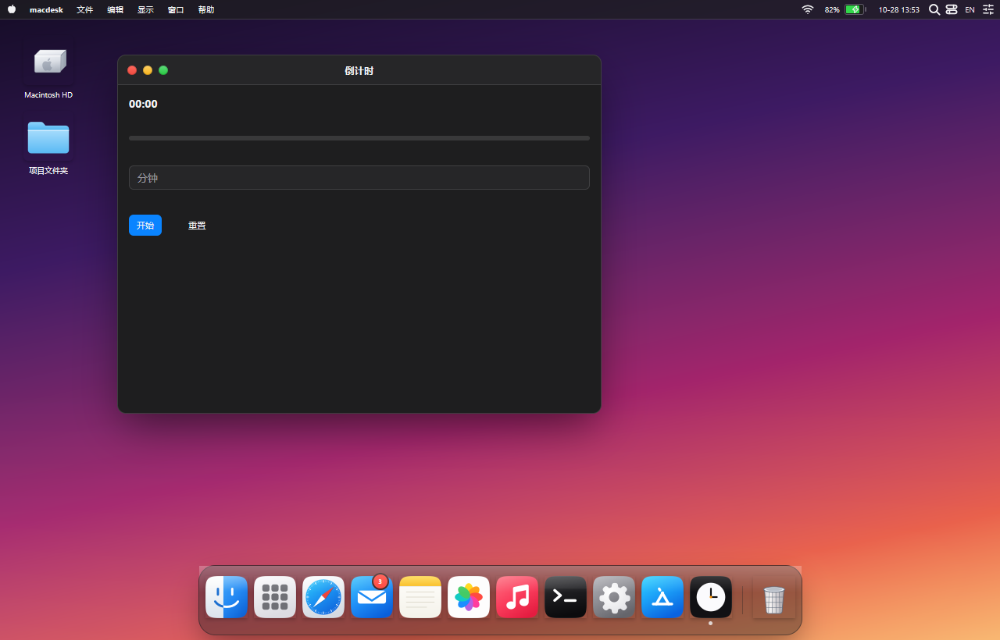
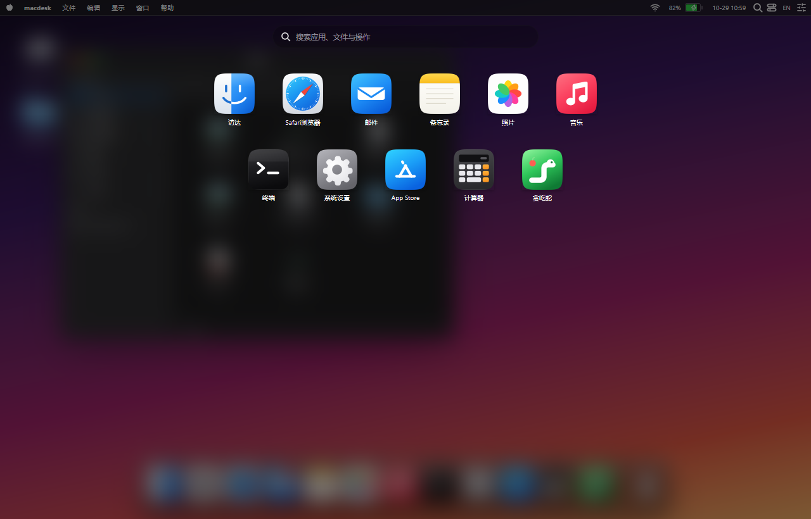
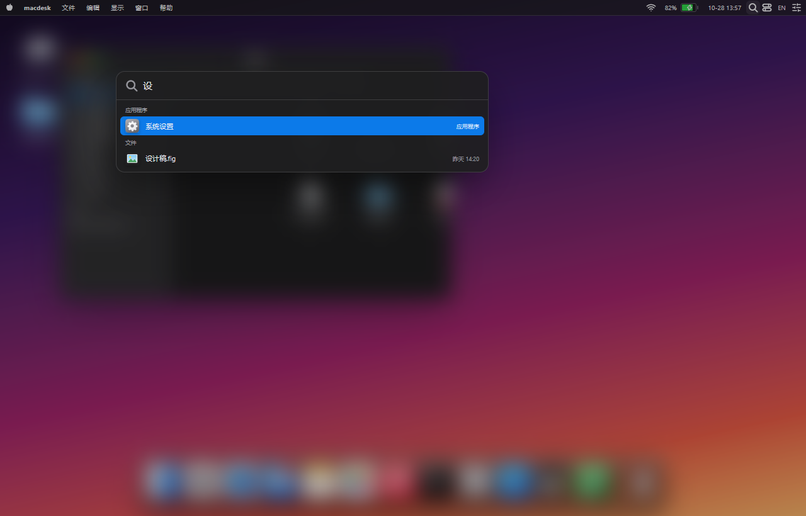
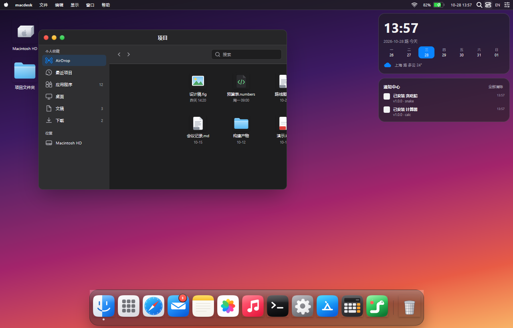
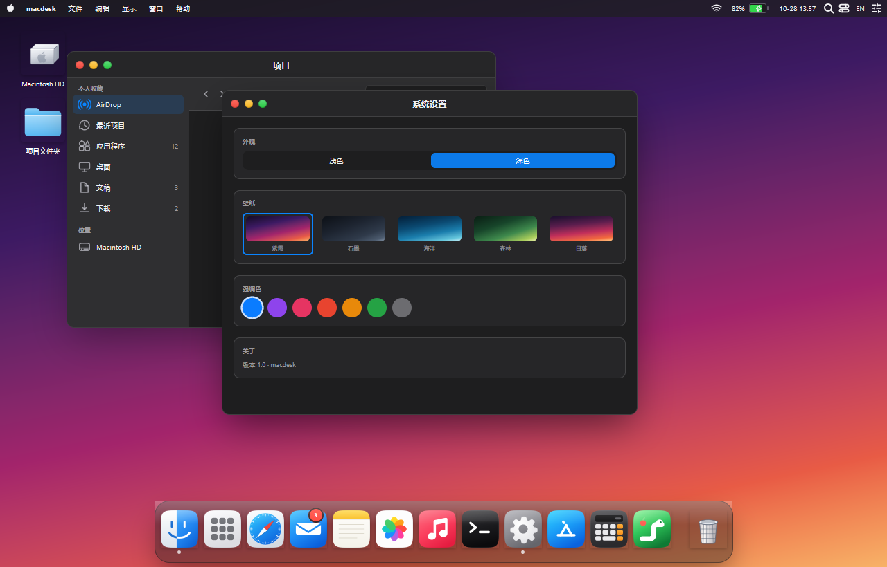
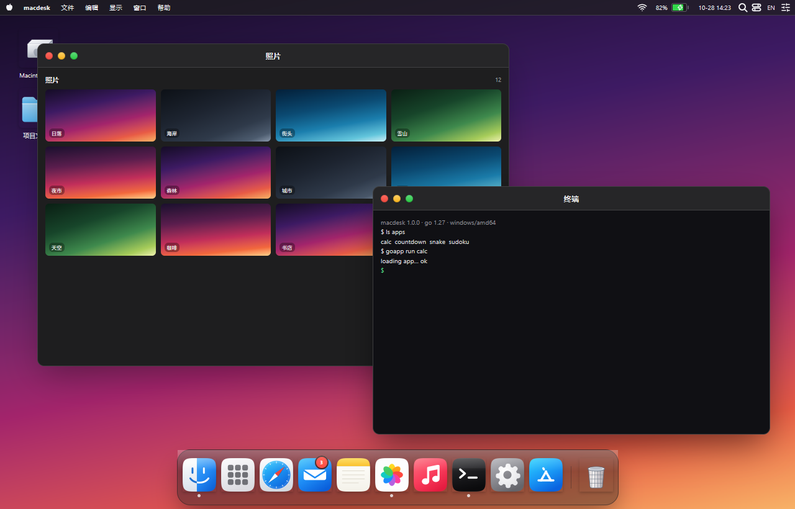

# macdesk

A macOS-style desktop that runs **Go apps you install at runtime** — an App Store, a dock, windows, a menu bar,
and small apps (calculator, countdown, snake, sudoku) written against a tiny declarative view API.

macdesk is a demo built on [MyGo](https://github.com/egoist/mygo) (native UI) and
[yaegi](https://github.com/traefik/yaegi) (Go interpreter). The desktop is compiled Go; the apps are `.goapp`
packages interpreted inside a sandbox, so installs need no compiler and no restart.

The look — glass dock, 25 DIP menu bar, 11 DIP windows, traffic lights, and the whole icon set — follows
[StarKnightt/macos-web](https://github.com/StarKnightt/macos-web): its design tokens and its 127 SVG icons are
rendered by MyGo's own SVG engine at any size.



Light appearance, same tokens and icons:



All 127 icons: app artwork, glyphs and file icons, drawn from one set:



## App Store

The dock's cart opens the store: installed apps, installable samples, an import field, and install/open/uninstall
buttons. Installing copies the package into `./apps/<id>/<version>/`, opening runs it, uninstalling deletes it.



An installed app runs in its own window and lives in the dock:



## The rest of the desktop

**Launchpad** (`F4` or the dock grid) blurs the desktop behind every installed app and filters as you type:



**Spotlight** (`⌘Space` or the menu-bar lens) searches apps, actions and files, arrows move, Enter runs:



**Notification Centre** (menu-bar toggle) holds the clock, the week strip, the weather and the app events:



**Settings** pick the appearance, one of five wallpapers and one of seven accent tones, live:



**Safari, Mail, Photos, Music and Terminal** open from the dock with the same chrome — a start page of favourites, a
mailbox list, a photo grid, a player and a shell transcript:



Right-clicking the desktop opens New Folder / Wallpaper / Launchpad / Spotlight / Empty Trash / About; right-clicking a
dock icon opens Open / Close Window / Quit. The trash keeps what you uninstall, and the dock shows it full.

## Quick start

```bash
go run .          # or: go build -o macdesk . && ./macdesk
```

Requires Go 1.27+. Installed apps live in `./apps/` (git-ignored). Delete that folder to start clean.

## Writing an app

An app is a folder (or a zip) with `manifest.json` and `main.go`, at most 2 MiB:

```json
{"id": "countdown", "name": "Countdown", "version": "1.0.0", "api": 1, "permissions": ["timer"]}
```

| Field | Rules |
| --- | --- |
| `id` | `[a-z0-9-]{1,32}`, also the storage folder |
| `name` | shown in the store, the window title and the dock |
| `version` | three numeric segments, `1.0.0` |
| `api` | must be `1` |
| `entry` | source file, default `main.go` |
| `icon` | optional name from the bundled set, e.g. `app-calculator`; see `appicons/svg/` |
| `permissions` | `timer` for `After`, `storage` for the storage calls |

`main.go` exports four hooks:

```go
package main

import (
	"strconv"

	"appkit"
)

type state struct{ left int }

func Open() any { return &state{left: 60} }

func View(s any) *appkit.Node {
	st := s.(*state)
	return appkit.Column(8,
		appkit.Text("seconds left: "+strconv.Itoa(st.left), "title"),
		appkit.Button("start", map[string]any{"type": "start"}, true),
	)
}

func Action(s any, a map[string]any) any {
	st := s.(*state)
	if a["type"] == "start" {
		st.left = 60
	}
	return s
}

func Close() {} // optional
```

`View` returns a tree of nodes the host renders; `Action` receives `{"type": "tick"}` for timers and touches, slider,
checkbox and input events, and returns the state to keep. See `sampleapps/` for four complete apps.

### appkit

| Call | What it makes |
| --- | --- |
| `Column(gap, children...)` / `Row(gap, children...)` | vertical / horizontal stack, gap in 4 DIP units |
| `Text(text, size)` | `title`, `title bold`, `body`, `caption` |
| `Button(label, action, primary)` | sends `action` when clicked |
| `Input(value, placeholder, action)` | one line, sends `{"text": value}` |
| `Image(lucideName, size)` | Lucide icon |
| `Progress(value, max)` / `Slider(value, min, max, action)` / `Checkbox(label, checked, action)` | values send `{"value"}` / `{"checked"}` |
| `Box(color, children...)` | tinted container, or a small tile when empty |
| `StorageGet` / `StoragePut` / `StorageDel` | per-app key-value JSON, needs `storage` |

Imports are limited to `appkit` plus `strconv`, `strings`, `math`, `math/rand` and `sort`. There are no goroutines,
files or network: with the `timer` permission the host calls `Action` with `{"type": "tick"}` about once a second.

### Pitfalls when writing apps

- Keep state in a struct pointer (`Open` returns `&state{}`). Mixing booleans and maps trips the interpreter.
- Read map values into a local before a `switch` or `if`; do not branch on an indexed expression directly.
- Assign `Children` instead of building huge variadic calls when a row is dynamic.

## How it works

```text
manifest + main.go  ──yaegi──▶  hooks  ──View()──▶  Node tree  ──render──▶  MyGo widgets
        │                          ▲                    │
        └── apps/<id>/<version>/   └──Action(evt)───────┘
```

- `apphost.go` compiles app source in a sandboxed interpreter, validates hooks, and calls them with a timeout.
- `appkit.go` is the node API and its interpreter symbol table; `viewtree.go` renders nodes with MyGo widgets.
- `installer.go` validates manifests and installs, imports (folder or zip) and prunes old versions.
- `appstore.go` is the store UI; `theme.go` holds the palettes, the wallpapers and the desktop metrics.
- `launchpad.go`, `spotlight.go`, `notifications.go`, `settings.go`, `trash.go` and `deskmenu.go` are the desktop
  overlays; `appwindows.go` holds the built-in windows; `desk.go` owns the state they read and `menubar.go` the menu bar.
- `appicons/` embeds the set: `svg/` is generated from macos-web's sheet by `tools/extract_icons.go`, `custom/` holds the
  hand-drawn and text-free redraws that win on a shared name.
- Widgets (`desktop/`, `display/`, `layout/`, `typography/`, `icon/`, `sound/`, `kit/`) come from
  [CrychicUI](https://github.com/ELY-Open-Source/CrychicUI).

## Tests

```bash
go vet ./... && go test ./...
```

The suite drives MyGo's tester: it installs samples, ticks timers, clicks cells, walks the interpreter's state and
checks the store flow end to end. `MACDESK_SHOTS=1 go test -run 'TestShoot' .` refreshes `docs/*.png`.

## Credits

- [StarKnightt/macos-web](https://github.com/StarKnightt/macos-web) for the icon set under `appicons/svg/`, the
  design tokens the palette here follows, and the squircle outline of the app icons. MIT.
- [MyGo](https://github.com/egoist/mygo) for the native UI and its SVG renderer, and
  [yaegi](https://github.com/traefik/yaegi) for the interpreter.
- [Lucide](https://lucide.dev) icons for the remaining glyphs, and CrychicUI for the macOS-flavoured widgets.

MIT licensed, see [LICENSE](LICENSE).
